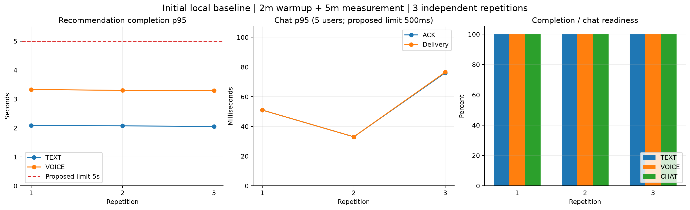
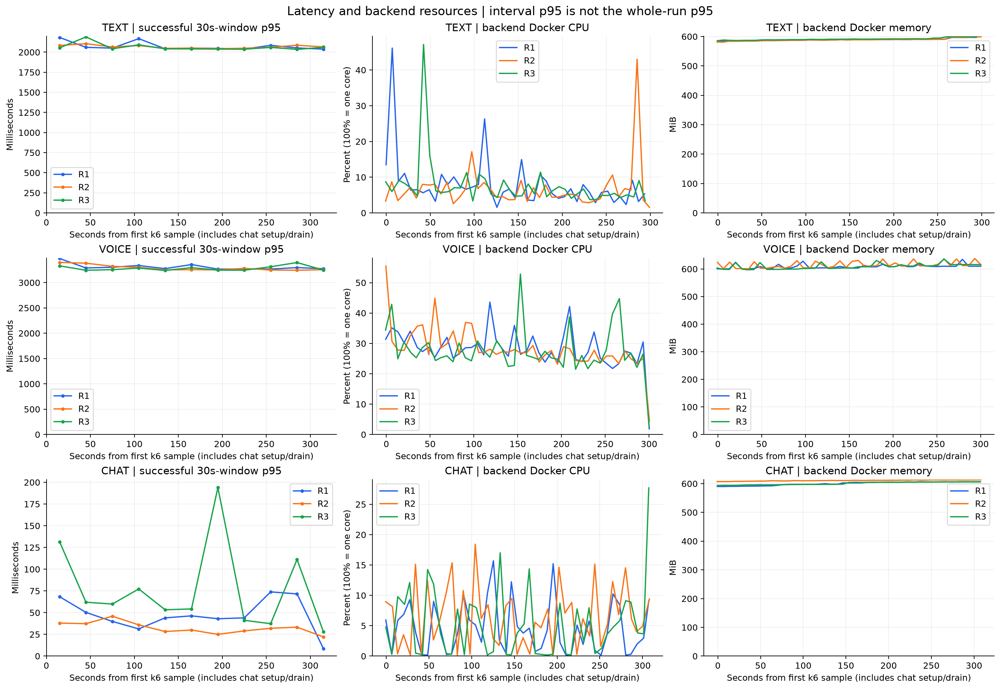

# 개선 전 기준 성능 — 2026-10-11

Mac·MySQL9.7.0·모의 AI에서 2분 워밍업 뒤 5분씩 3회 독립 측정했다. 운영 처리량이나 개선율이 아니다.

| 조건 | 회차 | 성공/실패 | 전체 p95(ms) | 수신 p95(ms) | 시작/전송 | dropped |
| --- | --- | --- | --- | --- | --- | --- |
| text-1rps | 1 | 300/0 | 2082.30 | — | 300 | 0 |
| text-1rps | 2 | 301/0 | 2074.00 | — | 301 | 0 |
| text-1rps | 3 | 300/0 | 2049.00 | — | 300 | 0 |
| voice-1rps | 1 | 301/0 | 3329.00 | — | 301 | 0 |
| voice-1rps | 2 | 301/0 | 3299.00 | — | 301 | 0 |
| voice-1rps | 3 | 301/0 | 3290.00 | — | 301 | 0 |
| chat-5users | 1 | 5/0 | 51.00 | 51 | 750 |  |
| chat-5users | 2 | 5/0 | 33.00 | 33 | 750 |  |
| chat-5users | 3 | 5/0 | 76.10 | 76.54999999999983 | 750 |  |

## 조건과 해석

- 호스트: arm64, 논리CPU 10개, 메모리 16GiB. k6와 Docker VM이 호스트를 공유한다.
- backend CPU2·메모리1GiB·JVM heap512MiB·Hikari10, MySQL CPU1·메모리1GiB·buffer pool256MiB, mock CPU1·메모리256MiB 조건이다. MySQL9.7.0과 각 실제 이미지ID를 고정했다.
- 모의 AI 첫text200ms·추천완료2000ms·전사1000ms·고정5곡 조건이다. 실제 AI·외부 지도·iTunes·로그인 부하는 제외한다.
- TEXT·VOICE 각각 초당 추천 시작1건, 측정300초다. VOICE는9.8초 MP4 업로드·전사→추천 done을 포함한다. 성공 처리량은 성공수/300초이며 HTTP 전체 RPS와 구분한다.
- 채팅 한 방5명이2초 간격으로150개씩 전송한다. 기대 전송750·수신3750(본인 포함)이며 readiness5명과 실제 ACK·방송·누락·중복·거절을 함께 확인한다. 요약 표의 채팅 성공수는 준비 완료 계정수다.
- 잠정 기준은 추천 p95<5초·완료율≥99%, 채팅 ACK/수신 p95<500ms·누락/중복/거절0이다. 서비스 SLO로 확정한 값은 아니다.
- 각 반복 전 전용4개 테이블 백업·초기화·backend 재기동을 수행했다. 워밍업은 집계에서 제외했다. 코드·JAR·모의 응답·자원·음성·이미지ID·k6 버전을 대조했다. 배치 중 변경은 백업 GTID 처리·scrape 대기·재개 및 분석 도구이며 제품·부하 조건은 유지했다.
- 실제 추천 시작은 회차에 따라300 또는301건이며 전부 기록했다. 채팅은 per-vu-iterations라 dropped_iterations가 적용되지 않아 CSV에는 비워두었다.
- p95는 각 실행 전체 성공 표본의 k6 summary 값이다. 3회 p95를 평균내 전체 p95로 표현하지 않았다. p99는 원본 성공 표본의 선형 보간 percentile이다. CSV의 전사 HTTP p95는 전사200 응답의 http_req_duration 원본에서 별도로 계산했으며 음성 전체 E2E와 구분한다.
- 그래프 추이의 p95는30초 구간 표본이다. 마지막 구간은 완료 대기 때문에 적은 표본일 수 있다. Docker CPU100%는1코어이며 backend 제한은2코어다. 자원 샘플은 약7초 간격이다.
- 현재 낮은 시작률과5명 방 조건만 확인했다. 최대 동접·한계 처리량·운영 성능·실제 AI 성능은 이 결과로 확정할 수 없다.
- 채팅 p95는33~76.55ms로 회차별 변동이 있다. 코드 변경 전후 결과가 아니므로 회차 차이를 개선율로 계산하지 않는다.
- Prometheus5초 표본에서 추천 대기열은0, 활성 추천은최대2로 관측됐다. Hikari 활성 연결은0~1로 관측됐지만 짧은 DB 작업은 수집 사이에 지나갈 수 있어 DB 병목 부재를 단정하지 않는다.
- 현 조건에서 잠정 기준을 모두 통과했다. 의미 있는 최적화 근거를 만들려면 별도 후속 실험에서 시작률·방 인원을 단계적으로 늘려 병목과 한계를 확인해야 한다.
- 실패 실행과 원본·DB백업은 비공개 results에 보존한다. CSV/그래프는 원본에서 파생했으며 비밀값·사용자 토큰을 포함하지 않는다.

## 원본 및 재생성

- 배치: `20261011T120430Z-baseline-batch`.
- 측정 조건 fingerprint: `1c8055fb2b8511714db5011317b5bd444a9e24b63f8d56dc28f6ffb6848c674b`.
- summary.csv, graph-data.json, 회차별 Prometheus query_range JSON, PNG·SVG를 함께 보존한다.
- matplotlib3.11.2 설치 Python에서 `python plot-baseline.py <배치 폴더> <출력 폴더>`로 재생성한다.

- 보존한 시계열로 오프라인 재생성하려면 `PERF_PROMETHEUS_CACHE=<기존 보고서 폴더>`를 설정하고 별도 출력 폴더를 지정한다. 실제 raw·자원·배치 원본은 함께 보존해야 한다.

- `text-1rps-r1` → `20261011T120644Z-recommendation-baseline`
- `text-1rps-r2` → `20261011T121407Z-recommendation-baseline`
- `text-1rps-r3` → `20261011T122134Z-recommendation-baseline`
- `voice-1rps-r1` → `20261011T123010Z-recommendation-baseline`
- `voice-1rps-r2` → `20261011T123740Z-recommendation-baseline`
- `voice-1rps-r3` → `20261011T124510Z-recommendation-baseline`
- `chat-5users-r1` → `20261011T125245Z-chat-baseline`
- `chat-5users-r2` → `20261011T130029Z-chat-baseline`
- `chat-5users-r3` → `20261011T130805Z-chat-baseline`