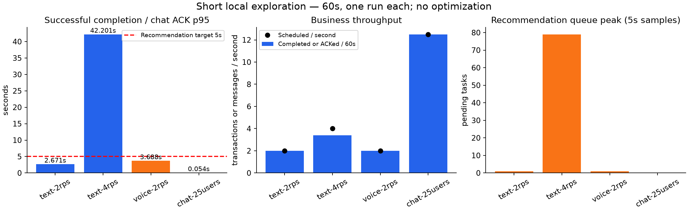

# 짧은 부하 탐색 결과

각 조건30초 워밍업·60초 탐색·1회 실행. MySQL9.7.0, 기존 제품 코드/자원, 모의 추천2초·전사1초. 5분·3회 기준선과 구분하며 운영 최대 수용량이나 개선율을 주장하지 않는다.

|조건|실행 VU 표본 최고|관측 진행 중 업무 최고|목표 TPS|완료/ACK 건수 ÷60초|전체 실행 HTTP RPS|p95 ms|완료율|대기열 표본 최고|
|---|---:|---:|---:|---:|---:|---:|---:|---:|
|text-2rps-r1|5|6|2|2.00|5.79|2671.2|100.0%|1|
|text-4rps-r1|87|87|4|3.38|5.88|42201.2|100.0%|79|
|voice-2rps-r1|7|8|2|2.00|7.60|3688.3|100.0%|1|
|chat-25users-r1|25|25|12.5|12.50|2.70|54.0|100.0%|0|

VU는 k6 가상 사용자 실행 풀이다. 추천의 관측 진행 중 업무 수는 started/completed 원본 이벤트의 차이이며 미리 할당50/최대150 VU와 구분한다. k6 vus gauge는 실행 중 VU의 주기적 표본이며 순간 최대는 업무 이벤트 차이로 보완한다. 채팅은 실제 접속25명이 각각2초 간격으로 보낸다.

완료 TPS의60초 분모는 입력 구간으로 정규화한 값이며 종료 뒤 drain에서 완료된 요청도 포함한다. 실제 전체 실행 평균은 summary.csv의 business_tps_full_run이다. HTTP RPS는 k6 전체 실행 평균이다. TEXT 성공 흐름3 HTTP·VOICE4 HTTP; 채팅 메시지는 WebSocket이므로 HTTP RPS로 메시지 처리량을 해석할 수 없다.

관측 실패·미전송·누락·중복은 summary.csv에 포함한다. exit99는 정한 성능 기준 위반이며 도구 실행 오류와 구분한다. 추천 p95는 성공한 요청만의 값이다. 대기열 gauge는5초 표본이며 짧은 변동을 놓칠 수 있다. histogram 30초 rate 기반 p95 최고는 근사치이며 k6 사용자 지연과 다르다.

채팅25VU:750건 전송·ACK,18750건 클라이언트 수신,누락/중복/거절0,ACK·수신p95 모두54ms. 송신 입력 구간으로 정규화한12.5msg/s와312.5delivery/s를 연결·정리 포함 평균10.53msg/s·263.33delivery/s와 구분한다.

추천 실행 풀은 코드상 core4/max8/queue100이다. TEXT4rps에서 실행4·대기열최고79가 관측돼 큐가 차기 전에 작업자가 늘지 않는 구조가 병목 후보다. 먼저150 VU를 사전 할당해 같은4rps를 재검증하고, 실행 풀/대기열 개선은 별도 조건에서 전후 반복 비교한다. 아직 개선율은 없다.

TEXT4rps는 본 측정 dropped38건·p95 약42초로 기준 위반이다. 시작된 요청100% 완료율은 미시작 요청을 제외한다. preAllocated50에서 실행 VU가 증가하는 동안 누락이 발생했으므로 고정150 VU 재검증으로 부하 발생기 영향을 분리해야 한다. 대기열/실행 풀 관측과 함께 병목 후보로 판단하며 최대 TPS를 확정하지 않는다.

원본: performance/results/20261011T133037Z-explore-batch/steps.jsonl 및 각 run_id의 raw.jsonl/summary.json/manifest.json. 개인 JWT/DB 백업은 비공개 results에 유지한다.

재생성: 임시 matplotlib 환경의 Python으로 performance/scripts/plot-explore.py <batch> <report> 실행. 저장된 Prometheus JSON은 재사용한다.
