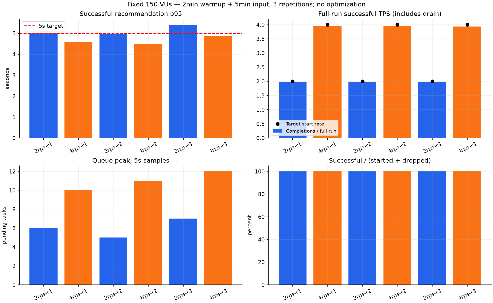
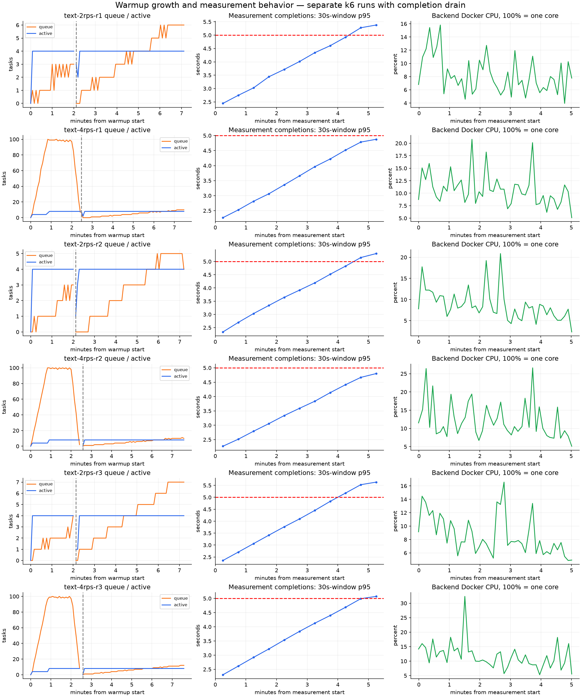

# 추천 고정 VU 반복 재검증

TEXT2/4rps, preAllocatedVUs=maxVUs=150, 조건별 초기화·재시작→2분워밍업→5분측정3회.2→4 순서3회 반복. MySQL9.7.0·고정mock추천2초·동일제품JAR/자원. 최적화 없음.

|조건|성공|실패|미시작|p95초|전체평균TPS|입력구간완료TPS|HTTP RPS|실행VU표본최고|대기열최고|실행작업최고|
|---|---:|---:|---:|---:|---:|---:|---:|---:|---:|---:|
|text-2rps-r1|600|0|0|4.999|1.969|1.967|5.908|10|6|4|
|text-4rps-r1|1201|0|0|4.603|3.941|3.940|11.823|18|10|8|
|text-2rps-r2|601|0|0|4.953|1.968|1.967|5.905|10|5|4|
|text-4rps-r2|1201|0|0|4.497|3.942|3.940|11.826|18|11|8|
|text-2rps-r3|601|0|0|5.413|1.966|1.963|5.899|11|7|4|
|text-4rps-r3|1200|0|0|4.871|3.937|3.937|11.811|20|12|8|

## 결과와 다음 판단

- 본 측정6회 합계5404건 모두완료,실패/미시작0. TEXT2p95 4.953~5.413초,3회중1회5초기준위반. TEXT4p95 4.497~4.871초.
- 선택된4rps워밍업3회 모두기준위반. 대기열100·실행작업4→8이관측됐고,합계10건이실패했다. 워밍업p95 28.149~28.205초. 서버rejected카운터도각회차실패건수와일치한다.
- 모든본측정에서후반지연·대기열증가가관측됐다. 4rps가5분전체p95를통과해도장시간안정적수용량이라고결론내리지않는다. 2rps도5초경계여서여유있는성능이라고표현하지않는다.
- 제품코드core4/max8/queue100과초기대기열이차기전에worker가늘지않는시계열이일치한다. 부하발생기150VU고정에서dropped0인상태로이패턴이재현돼추천실행풀/대기열정책이우선개선대상이다. CPU/DB표본만으로다른병목을배제하지않는다.
- 다음은실행풀/대기열정책의한가지개선과같은조건전후비교다. 모의AI지연·DB버전·자원을고정하고기준위반/초기거절/후반지연을함께비교한다. 실제제품최적화나개선율산출은아직없다.
- 시간역행으로음수15개가나온원래4rps-r2본측정과짝워밍업은비교에서제외하고동일조건재실행으로대체했다. 실패를제외한것이아니며2rps-r3의유효지연기준위반은유지했다. 모든제외원본과사유는run-selection.json및비공개results에보존한다.
- 최초셸기록오류시도1개,원래배치12실행,대체2실행총15실행을보존했다. 정식선택12개중6개는워밍업,6개는본측정이다. 실행은2026-10-11~12KST이며대체전약25분간격이있다.

## 해석 범위

- VU150은 사전 할당 풀이다. 실제 실행 중 VU표본 및 started/completed이벤트 기반 업무 동시진행 최고는 CSV에 구분한다.
- 전체 평균TPS는 종료대기 포함 k6전체기간 분모이다. 입력구간TPS는 시작 이후300초 안에 완료된 성공건수/300이며 이후완료는 제외한다. successes_per_input_second는 drain완료도 포함한 정규화 수치다. HTTP RPS는전체평균이며 성공TEXT1업무는3HTTP흐름이다.
- p95/p99는 성공만의 지연이며 완료율·실패·미시작과 함께 해석한다. 원본p95를 독립 재계산해12실행summary와 대조했다. 종료코드99는기준위반,0은기준통과다.
- 워밍업은 별도 k6실행이며 모든 started업무가 종료된 후 측정을 시작한다. 요청대기열은그 사이비워질 수 있고 늘어난worker는남을 수 있다. 이 결과는 같은 절차의 개선전 비교근거이며 연속부하/콜드스타트/장시간soak/운영수용량을대체하지 않는다.
- queue/active/DBpool은5초표본이다. histogram30초rate p95는근사치이며 상단bucket30초를넘는꼬리정밀도가제한된다. 측정초기30초query는워밍업종료구간을포함할수 있다. rejected카운터최고는백엔드재시작이후누적값이므로워밍업거절도포함한다. queue마지막표본은종료완료시점이전일수있다. 30초지연그래프의마지막빈은종료대기의부분구간표본을포함한다.
- DockerCPU100%=한코어,메모리는컨테이너RSS/캐시측정이며heap아니다. Mac전체·mock·모니터링자원경쟁은존재한다.
- 정식12실행에서제외한첫워밍업시도의사전옵션파일은inspect기본env미전달문제로smoke설정이기록돼배치에corrected옵션을별도보존했다. 원본은수정하지않았고실제console의RATE/기간/VU와raw건수를검증했다. 이후inspect는system-env전달옵션으로수정했다.

## 원본과 재생성

비공개원본: performance/results/20261011T134814Z-validation-batch/ 및 CSV각run_id의raw.jsonl·manifest.json·summary.json·console.txt. 백업/JWT는공개하지 않는다.

summary.csv는6측정,all-runs.csv는12워밍업/측정,graph-data.json은시계열과원본SHA,각prometheus.json은조회캐시다. 보고서artifact-hashes.json은결과파일해시이다.

재생성: matplotlib/numpy환경Python으로 performance/scripts/plot-validation.py <batch> <report> 실행. Prometheus캐시가있으면네트워크없이재생성하며timestamp를검증한다.
